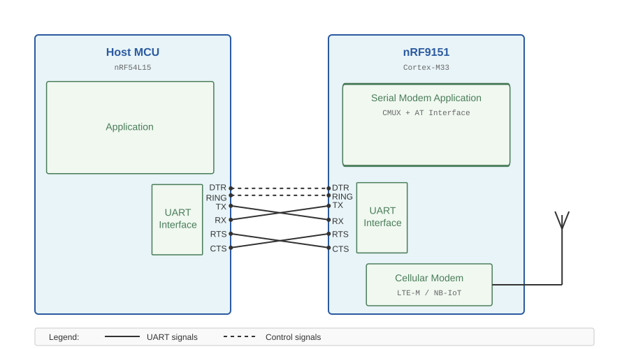
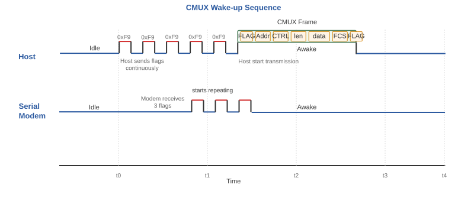

.. _uart_configuration:

UART configuration
##################

.. contents::
   :local:
   :depth: 2

This section describes the UART configuration for the |SM| application.

UART interface
**************

A typical |SM| application configuration consists of a host processor connected to an nRF91 Series SiP through a UART interface.
The UART connection serves as the physical transport layer, carrying both AT commands and PPP data frames for network communication.

   UART interface setup

The following UART signals are used:

.. list-table::
   :header-rows: 1
   :widths: 15 20 65

   * - Signal
     - Direction
     - Purpose
   * - TX/RX
     - Bidirectional (crossed)
     - Data transmission
   * - RTS/CTS
     - Bidirectional (crossed)
     - Hardware flow control
   * - DTR
     - Host → Modem
     - *Data Terminal Ready* - Host signals UART is powered on
   * - RI
     - Modem → Host
     - *Ring Indicator* - Modem wakes host for incoming data

The Data Terminal Ready (DTR) and Ring Indicator (RI) signals are the **control signals** used for UART power management, while TX/RX/RTS/CTS are the standard UART signals.

.. important::
   The use of |SM| without hardware flow control (RTS/CTS) is :ref:`experimental <nrf:software_maturity>` and strongly not recommended.
   See :ref:`uart_without_flow_control` for more information.

Board-specific pin mapping
**************************

The UART configuration varies depending on the board and whether it is running the |SM| application (nRF9151) or a host application (for example, nRF54L15).

UART configuration is done in the devicetree as a build time configuration.

|SM| application (nRF9151)
==========================

The following tables shows how to connect the UART pins to the corresponding pins on the nRF91 Series SiP:

.. tabs::

   .. group-tab:: USB UART with PC host

      .. list-table::
         :header-rows: 1

         * - UART Signal
           - nRF9151 Pin
         * - TX
           - P0.27
         * - RX
           - P0.26 (pull-up)
         * - RTS
           - P0.14
         * - CTS
           - P0.15 (pull-up)
         * - DTR
           - P0.08 (Button 1, pull-up, active high)
         * - RI
           - P0.00 (LED1)

      * UART instance: UART0 (VCOM0 on the interface chip)
      * Baud rate: 115200
      * Hardware flow control: Enabled

      The DTR pin defaults to pull-up with an active high level, so the UART is always powered on.
      This pin is shared with **Button 1**, which you can use to manually toggle the DTR state.
      When the button is pressed, DTR is pulled low (inactive), powering down the UART.

      The RI pin is connected to **LED1**, as it is not routed to the host PC.

      This setup is default when building for nRF9151 DK without any overlay files.

   .. group-tab:: external MCU as host

      .. list-table::
         :header-rows: 1

         * - UART Signal
           - nRF9151 Pin
         * - TX
           - P0.02
         * - RX
           - P0.03 (pull-up)
         * - RTS
           - P0.06
         * - CTS
           - P0.07 (pull-up)
         * - DTR
           - P0.31 (active low, pull-up)
         * - RI
           - P0.30 (active low)

      * UART instance: UART2
      * Baud rate: 115200
      * Hardware flow control: Enabled

      On the :doc:`nrf9151dk <zephyr:boards/nordic/nrf9151dk/doc/index>` board, UART data and flow control pins (TX, RX, RTS, CTS) are on the **P4** connector, while control signals (DTR, RI) are on the **P3** connector.

      The DTR pin defaults to pull-up, so the external MCU must assert DTR to power on the UART.
      When UART power management is not used, the DTR pin should be pulled to active state.

      When hardware flow control is not used, remove ``hw-flow-control;`` from the ``uart2`` node and remove the ``bias-pull-up`` from the CTS pin in the overlay.
      With hardware flow control disabled, the UART peripheral does not monitor the CTS pin, so |SM| transmits unconditionally.
      The RTS and CTS pins can be left unconnected.
      See :ref:`uart_without_flow_control` for further considerations.

      This setup is provided in the :file:`app/external-mcu.overlay` overlay file.

      .. note::

         DTR and RI pins use the **P0.31** and **P0.30** pins, which are shared with the I2C2 instance on the :doc:`nrf9151dk <zephyr:boards/nordic/nrf9151dk/doc/index>` board.
         I2C2 must stay disabled to use these pins for DTR and RI signals.

   .. group-tab:: Thingy:91 X with PC host

      .. list-table::
         :header-rows: 1

         * - UART Signal
           - nRF9151 Pin
         * - TX
           - P0.00
         * - RX
           - P0.01
         * - DTR
           - P0.26 (Button 0, pull-up, active high)
         * - RI
           - P0.30 (blue LED)

      * UART instance: UART0 (VCOM0 on the interface chip)
      * Baud rate: 115200
      * Hardware flow control: Disabled

      Hardware flow control is disabled, as there are no RTS and CTS pins on the Thingy:91 X interface chip.

      The DTR pin defaults to pull-up with the active high level, so the UART is always powered on.
      This pin is shared with **Button 0**, which you can use to manually toggle the DTR state.
      When the button is pressed, DTR is pulled low (inactive), powering down the UART.

      The RI pin is connected to the blue LED, which is used to indicate incoming data.

.. uart_power_pins_start

Power and reset pins
====================

The following pins supply, power on, and reset the |SiP|:

.. list-table::
   :header-rows: 1

   * - Signal
     - |SiP_pin|
   * - `ENABLE <nRF9151 Hardware Design Guidelines — ENABLE_>`_
     - 10 (active high)
   * - `nRESET <nRF9151 Hardware Design Guidelines — nRESET_>`_
     - 9 (active low, external pull-up not allowed)
   * - `VDD <nRF9151 Hardware Design Guidelines — VDD_>`_
     - 14
   * - `VDD_GPIO <nRF9151 Hardware Design Guidelines — VDD_GPIO_>`_
     - 65

The |SM| firmware has no watchdog.
The host must therefore be able to reset the |SiP| to a known state, either by power cycling it with **ENABLE** or by using **nRESET**.

.. note::
   The pins listed here are not the only pins that can be useful with the |SiP|.
   For the complete pin list, see the `nRF9151 LGA pin assignments`_.
   For hardware integration guidance, see the `nRF9151 Hardware Integration`_ page.

.. uart_power_pins_end

.. _uart_configuration_nrf91m1:

nRF91M1 pre-programmed |SM| application
=======================================

nRF91M1 is a pre-programmed nRF9151 SiP that runs the |SM| application out of the box.

For the UART configuration of the nRF91M1, see the `nRF91M1 UART configuration`_ appendix in the nRF91M1 AT Commands documentation.

This setup is provided in the :file:`app/nrf91m1.overlay` devicetree overlay file.

.. _uart_configuration_interposer:

Interposer boards
=================

An interposer board adapts the nRF9151 SiP to the footprint of another cellular module.
The interposer wiring determines which nRF9151 pins carry the UART signals, so each interposer needs its own devicetree overlay.

Both overlays target the :doc:`nrf9151dk <zephyr:boards/nordic/nrf9151dk/doc/index>` board.
Each one assigns its own pinctrl states and points ``uart0`` at them, so the pin mapping does not depend on the states the board files happen to define.

.. tabs::

   .. group-tab:: nRF9151-MK-BG95 interposer

      .. list-table::
         :header-rows: 1

         * - UART Signal
           - nRF9151 Pin
         * - TX
           - P0.15
         * - RX
           - P0.14 (pull-up)
         * - RTS
           - P0.18
         * - CTS
           - P0.19 (pull-up)
         * - DTR
           - P0.08 (Button 1, pull-up, active high)
         * - RI
           - P0.00 (LED1)

      * UART instance: UART0
      * Baud rate: 115200
      * Hardware flow control: Disabled

      The overlay remaps the ``uart0`` pins to match the interposer footprint and removes ``hw-flow-control``.
      DTR and RI keep the :doc:`nrf9151dk <zephyr:boards/nordic/nrf9151dk/doc/index>` board defaults.

      The RTS and CTS pins are still assigned in the pinctrl states but are not used for flow control, and both can be left unconnected.
      See :ref:`uart_without_flow_control` for further considerations.

      This setup is provided in the :file:`app/interposer-nrf9151-mk-bg95.overlay` devicetree overlay file.

   .. group-tab:: nRF9151-MK-GM02S interposer

      .. list-table::
         :header-rows: 1

         * - UART Signal
           - nRF9151 Pin
         * - TX
           - P0.08
         * - RX
           - P0.07 (pull-up)
         * - RTS
           - P0.05
         * - CTS
           - P0.04 (pull-up)
         * - DTR
           - P0.15 (pull-up, active high)
         * - RI
           - P0.00 (LED1)

      * UART instance: UART0
      * Baud rate: 115200
      * Hardware flow control: Enabled

      The interposer routes UART0 TX to **P0.08**, which the :doc:`nrf9151dk <zephyr:boards/nordic/nrf9151dk/doc/index>` board overlay uses for DTR.
      The overlay therefore moves DTR to **P0.15**, which UART0 CTS no longer occupies.

      .. note::

         RI, together with the UART0 pins, overlaps **LED 1** (**P0.00**), **LED 3** (**P0.04**), **LED 4** (**P0.05**) and **Button 1** (**P0.08**) on the :doc:`nrf9151dk <zephyr:boards/nordic/nrf9151dk/doc/index>` board.
         The overlay disables the LED, PWM LED and button nodes so that nothing else can drive those pins.

      This setup is provided in the :file:`app/interposer-nrf9151-mk-gm02s.overlay` devicetree overlay file.

Host application
================

.. tabs::

   .. group-tab:: PC serial terminal

      When using a PC serial terminal application (for example, PuTTY, Tera Term, minicom), build the |SM| application with the PC host.
      This is the default configuration when building for nRF9151 DK:

      * UART instance: VCOM0
      * Baud rate: 115200
      * Hardware flow control: RTS/CTS Enabled
      * Line terminator: CRLF
      * AT command terminator: CR

      When configuring the serial terminal application, ensure that return key sends **CR** (Carriage Return) character as the line terminator.
      For incoming serial output from the modem, both **CR** and **LF** (Line Feed) characters are used.
      This is the most common configuration for AT command terminals.

      This setup is the default for Tera Tearm, Putty, Minicom, and Picocom serial terminal applications.

   .. group-tab:: nRF54L15DK

      The nRF54L15DK host applications use UART30 for |SM| communication:

      .. list-table::
         :header-rows: 1

         * - UART Signal
           - nRF54L15 Pin
         * - TX
           - P0.00
         * - RX
           - P0.01
         * - RTS
           - P0.02
         * - CTS
           - P0.03
         * - DTR
           - P1.11
         * - RI
           - P1.12

      UART0 on the P0 connector is the ``uart30`` instance in the devicetree and is routed to VCOM0 on the interface chip.
      This must be disabled in the `Board Configurator app`_ to release the UART pins for external use.

      UART1 is routed to VCOM1 on the interface chip.
      The VCOM1 is used for console/shell.

      RI and DTR signals are located on the P1 connector.

      .. note::
         Disable VCOM0 from `Board Configurator app`_ to release UART30 for |SM|.

   .. group-tab:: Native simulator

      For native simulator testing, UART2 is configured to use a host serial port:

      .. code-block:: devicetree

         uart2: uart2 {
             status = "okay";
             compatible = "zephyr,native-tty-uart";
             serial-port = "/dev/ttyACM0";
             current-speed = <115200>;
             hw-flow-control;

             modem: modem {
                 compatible = "nordic,nrf91-slm";
                 status = "okay";
                 zephyr,pm-device-runtime-auto;
             };
         };

      Build the |SM| application with the PC host.
      The UART0/VCOM0 from |SM| is assumed to be connected to ``/dev/ttyACM0`` on the Linux host.

      See the :ref:`sm_ppp_shell_sample` for more information.

.. uart_power_management_start

Controlling the UART power state
********************************

The UART power state of the |SM| is controlled by the **DTR** signal.
When DTR is asserted by the host, the UART is enabled and ready for communication.
When DTR is deasserted, the UART is powered down to save power.

When the UART is powered down, it releases its high-speed clocks, which are then automatically stopped by the system's power management.
This achieves the lowest possible power consumption, as the UART is one of the primary power consumers in |SM|.
Power consumption can be reduced from hundreds of microamps to just a few microamps when the UART is powered down.

UART power management is completely independent of the modem power management (CFUN, PSM, eDRX, and so on).
By actively managing the UART power state through DTR control, the |SiP| achieves ultra-low power consumption of approximately 2 µA when the cellular modem enters  Power Saving Mode (PSM) and the UART is powered down.
This is a reduction of over 99% compared to the 400-450 µA consumed when the UART remains active during idle periods.
The |SiP| retains all the RAM content while in any of the power saving modes, so the application can resume from where it left off when the UART is powered up.
Full network context is maintained, including socket connections, TLS/DTLS sessions, and so on.
LTE connection is automatically resumed when there is outgoing data to be sent.
No other GPIO control is required to utilize the PSM or eDRX modes.

.. _uart_incoming_data_wake_up:

Incoming data wake-up
=====================

When the UART is powered down and there is incoming data, the |SM| asserts the **RI** pin to notify the host.
The host must handle the RI signal by powering up its UART device and asserting the DTR line, signaling to the |SM| that the UART is powered on and ready to receive data.
The RI signal remains asserted until the UART is activated and ready to transmit data.

.. figure:: /images/cmux-wakeup-timing.svg
   :alt: Modem waking up the host timing diagram

   Sequence diagram showing the wake-up sequence when the UART is powered down

This sequence diagram illustrates the wake-up sequence when the UART is powered down.
The RI signal triggers the host to power up its UART and assert DTR.
Once the host UART is ready and DTR is asserted, the |SM| enables its UART interface.
The RI signal remains active throughout this process and only returns to inactive once the |SM| UART is active.
This coordinated wake-up ensures both ends of the communication link are ready before data transmission begins.

**With hardware flow control -**  The host can observe its CTS pin (connected to |SM|'s RTS) to know when |SM| is ready to receive data.
When |SM| starts driving its RTS pin, the host knows that |SM| is ready to receive.
The host must also have a pull-up on its CTS pin.

**Without hardware flow control-** The host must monitor the RI signal, which is de-asserted when the |SM| UART becomes ready to receive data.
Alternatively, the host can implement a sufficient timeout between asserting DTR and initiating its first TX operation.
See :ref:`uart_without_flow_control` for how to configure |SM| to transmit without hardware flow control.

Host-initiated wake-up
======================

When the host processor needs to send data, it first powers up the UART device, then asserts the DTR signal to indicate that the UART is active.
The modem detects the DTR assertion and powers up its UART interface, allowing communication to resume.

.. figure:: /images/cmux-host-wakeup-modem.svg
   :alt: Host waking up the modem

   Sequence diagram showing host-initiated wake-up of the modem

Boot-up scenario
================

To boot-up the |SM|, the host asserts **ENABLE**, **DTR**, and enables its UART (driving |SM| **CTS** low).
The |SM| firmware initializes within approximately 2000 ms, during which it activates its UART and asserts **RTS** to signal readiness.
|SM| then transmits a ``"Ready"`` message on **TX**, confirming that the link is operational.

.. figure:: /images/boot-up-sequence.svg
   :alt: Boot-up sequence diagram

   Signal sequence during boot-up

The **ENABLE** pin (pin **10** on the |SiP|) is a high-impedance control input for the internal power management unit (PMU) of the |SiP|.
Driving it to a logic high powers on the |SiP|.
Driving it to a logic low brings the device into an extremely low-current state.
Any internal state not retained in non‑volatile memory is lost, and a full boot-up sequence is required when **ENABLE** is reasserted.
See `nRF9151 Hardware Design Guidelines — ENABLE`_ for more information about the ENABLE pin.

Reset scenario
==============

To reset the |SiP| to a known state, do one of the following:

* Drive **nRESET** low for at least 5 µs.
* Power cycle the |SiP| with **ENABLE**.
  Keep **ENABLE** low for at least 1 s.

After the reset, the startup sequence is the same as in the `Boot-up scenario`_.

.. uart_power_management_end

.. _uart_without_flow_control:

Operating without hardware flow control
========================================

.. important::
   The use of |SM| without hardware flow control (RTS/CTS) is :ref:`experimental <nrf:software_maturity>` and strongly not recommended.
   Hardware flow control ensures reliable communication and prevents timing-related issues.
   Without hardware flow control, there is a risk of data loss in UART communication, especially in high-throughput scenarios.

The approach for a custom |SM| build is the following:

* **Remove** ``hw-flow-control;`` **from the UART node in the overlay** — With hardware flow control disabled, the UART peripheral does not monitor CTS and |SM| transmits unconditionally.
* **Remove the** ``bias-pull-up`` **from the CTS pinctrl group in the overlay** — This avoids a pull resistor drawing current against any external signal.
* **Leave RTS and CTS unconnected** — Neither pin is used and both can be left floating.

**Key requirements:**

* The host must enable its own UART before asserting DTR.
* To detect when |SM| is ready to receive, monitor the RI signal (de-asserted when ready) or use a sufficient timeout after DTR assertion.
* See `Incoming data wake-up`_ for detailed timing information.
* In boot-up scenarios, the host must wait for the ``"Ready"`` message from |SM| before sending any data.

**Buffer configuration:**

Increase :option:`CONFIG_SM_UART_RX_BUF_SIZE` and possibly :option:`CONFIG_SM_UART_RX_BUF_COUNT` to provide sufficient buffer space for your use case.

.. _uart_zephyr_cellular_modem_driver:

Automatic UART power management using Zephyr's Cellular Modem driver
====================================================================

As the |SM|'s UART interface power state is controlled by the DTR signal from the host, it is possible to automate the power management using Zephyr's cellular modem driver with Zephyr's CMUX (3GPP TS 27.010) module.
This allows host applications to manage the UART power state automatically.
See the `Zephyr CMUX Power Saving`_ documentation for more information.
This configuration is completely done in the host.
|SM| does not require any changes as it already follows the DTR signal state for UART power management.

You can configure the Zephyr's cellular modem driver to automatically power on and off the UART device based on the data traffic on the CMUX DLCI channels.
This is done by setting the ``cmux-enable-runtime-power-save`` and ``cmux-close-pipe-on-power-save`` configuration options.
When PPP is connected, the UART is automatically powered down when the PPP connection is idle for a certain period of time (configurable with the ``cmux-idle-timeout-ms`` configuration option).

The following example shows how to configure automatic UART power management for the nRF54L15DK host application:

.. code-block:: devicetree

   /* Zephyr modem UART <-> nRF91 Serial Modem UART */
   &uart30 {
       status = "okay";
       current-speed = <115200>;
       hw-flow-control;
       zephyr,pm-device-runtime-auto;

       /* Nordic nRF91 Serial Modem configuration */
       modem: modem {
           compatible = "nordic,nrf91-slm";
           status = "okay";
           mdm-ring-gpios = <&gpio1 12 (GPIO_ACTIVE_LOW | GPIO_PULL_UP)>;
           mdm-dtr-gpios = <&gpio1 11 GPIO_ACTIVE_LOW>;
           zephyr,pm-device-runtime-auto;
           cmux-enable-runtime-power-save;
           cmux-close-pipe-on-power-save;
           cmux-idle-timeout-ms = <5000>;
       };
   };

**Key devicetree options:**

* ``zephyr,pm-device-runtime-auto``: Enables automatic runtime power management for the UART device
* ``cmux-enable-runtime-power-save``: Enables CMUX power saving mechanism
* ``cmux-close-pipe-on-power-save``: Closes the pipe when entering power save mode
* ``cmux-idle-timeout-ms``: Timeout in milliseconds before entering idle state (5000 ms in this example)

The setup above also required the :kconfig:option:`CONFIG_PM_DEVICE_RUNTIME` and :kconfig:option:`CONFIG_PM_DEVICE_RUNTIME_ASYNC` Kconfig options to be enabled.

When the cellular modem driver enters the idle state and there is no data to be sent or received on any DLCI channel, the UART device is powered down.
When the cellular modem driver exits the idle state and there is data to be sent or received on any DLCI channel, the UART device is powered up.

   CMUX wake-up sequence showing flag character exchange

The CMUX wake-up sequence consists of the peer repeatedly sending flag characters (``0xF9``) on the UART.
The remote peer, upon detecting these flags, responds with its own flag character to indicate it is awake and ready to receive data.
This handshake ensures both ends of the communication link are synchronized before data transmission resumes.
As the flag characters carry no information, there is no issue of losing data when waking up.
When the peer that initiates the wake-up receives a flag character, it can continue by sending a valid frame.
Either end of the CMUX channel can initiate the wake-up procedure.

See the :ref:`sm_ppp_shell_sample` for an example of how to configure the CMUX module to automatically power on and off the UART device based on the data traffic on the DLCI channels.

.. nrf91m1_uart_security_models_start

.. _uart_security_models:

UART security considerations
****************************

UART is a plain serial link with no built-in encryption or authentication, so data that the host and the |SM| exchange over the UART is therefore not protected.
You can reduce the exposure by keeping the UART lines hidden inside the physical security boundary of your product.
When you need stronger confidentiality, terminate secure protocols on the host instead of in the modem.

The following data is sent over the UART in cleartext:

* Application data sent and received over modem-terminated TLS or DTLS sockets.
* AT commands, responses, and notifications exchanged with the |SM| that may contain sensitive information.

Choose one of the following security models based on the physical security of your product.

.. list-table::
   :header-rows: 1
   :widths: 20 40 40

   * - Aspect
     - Model A: Trusted UART
     - Model B: Untrusted UART
   * - When to use
     - The UART lines are inside the physical security boundary of the product.
     - The UART lines are accessible outside the physical security boundary of the product, or the product requires stronger confidentiality.
   * - Credential storage
     - Credentials are stored in the modem with ``AT%CMNG``.
       Provision them in a controlled environment, such as the production line.
     - Credentials are stored on the host.
       No credentials for internet services are written to the modem.
   * - Secure channel
     - Secure protocols, such as TLS, DTLS, MQTT, and HTTP, are terminated in the modem and controlled with AT commands.
     - All internet protocols, such as TLS, DTLS, MQTT, HTTP, and CoAP, are terminated on the host.
       The host uses :ref:`PPP <SM_AT_PPP>` over :ref:`CMUX <SM_AT_CMUX>` and the modem only forwards IP packets.
   * - Data on the UART
     - Application data and AT commands are in cleartext.
     - Application data is encrypted by the host.
       AT commands are still in cleartext.
       Commands that configure the modem, such as the SIM PIN, PDN authentication credentials, and SMS content, can carry sensitive data.
       Apply these settings in a controlled environment where possible.
       Commands that are needed in the field remain visible on the UART.

.. note::
   Firmware integrity does not depend on the UART.
   Firmware updates are signature-verified on the device, regardless of the security model.

.. nrf91m1_uart_security_models_end
